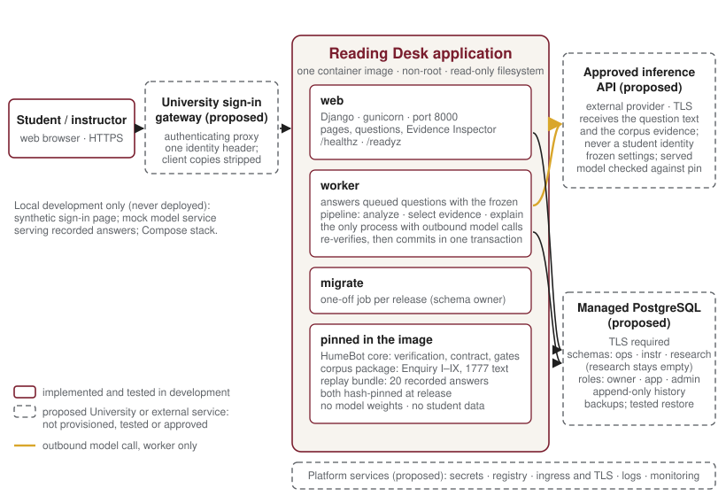

About this report

<dl>

<dt>Central question</dt><dd>What has been built, and how could the University operate it?</dd>

<dt>Audience</dt><dd>University IT and cloud-services colleagues who would host, operate or review the application.</dd>

<dt>Evidence and scope</dt><dd>The application as it exists in development on 8 November 2026, the frozen generation pipeline behind it, and the University services a deployment would need. Statements about the software were checked against the repository and the project's technical documents. Experimental results are cited in one sentence each; their methodology and limits are in Report 5.</dd>

<dt>Status</dt><dd>A faculty-led development prototype: not deployed, not handed to the University, not approved for student use. No live model configuration is qualified or accepted. Nothing here is an institutional commitment.</dd>

</dl>

## Executive summary, scope and implementation status

HumeBot is a reading and question-answering environment for David Hume's *Enquiry concerning Human Understanding*. A student asks a question; a language model analyzes it, selects evidence from a controlled transcription of Hume's text and writes an explanation; software built around the model verifies every quotation and citation against that transcription before anything is shown, and displays the explanation beside the verified passages. The project calls that software layer the **normative harness**: the deterministic components that construct displayed text from the controlled corpus, verify every quotation and location, keep the kinds of claim visibly distinct, withhold what fails their checks and record what happened. The division of responsibilities is the architecture's central idea. **The model generates the philosophical explanation; the normative harness governs evidence, provenance, response structure and verification.** What the harness verifies is textual: that a quotation is Hume's, at the place cited, drawn from the evidence the model was given, and tied to the sentence that cites it. Whether the passage supports the interpretation remains a philosophical judgment, and the application says so to its readers.

This report keeps six things distinct, because they are at different stages and none of them is a qualified classroom system:

- the **frozen generation candidate**, `humebot-iq-candidate-0.1`: the three-stage pipeline with its prompts and settings frozen in September 2026, developed with an open-weight model;
- the **Reading Desk release candidate** 1.0.0-rc1 (29 October 2026), the containerized application described here;
- a **later development build** (1.1.0-dev.2, 3 November 2026) that adds a course reading commons, for synthetic use only;
- **twenty recorded answers**, produced in the project's research with a frontier model run through the unchanged prompts, bundled with the application for demonstration and testing;
- the **live inference path**, implemented in full and exercised only against a local stand-in model service;
- the **proposed University production configuration**: platform, database, sign-in and an approved inference service, none of it provisioned.

**What exists today.** A containerized web application (Django on Python, PostgreSQL 16): one image, three processes, running as an unprivileged user on a read-only filesystem, with liveness and readiness probes, every setting taken from the environment and unsafe configurations refused at start-up. Two answer sources, recorded and live, share one verification, persistence and display path: every answer is re-verified against the pinned corpus and committed with its audit records before it is displayed, and verified again at each display. Identity comes from a single trusted header set by an authenticating proxy, the pattern University single sign-on gateways provide; course roles default to deny; provisioning is audited; instructors have an Evidence Inspector; instructional history is append-only; and logs never carry question text, model output or credentials. All of it has been tested in development with synthetic identities, recorded answers and a mock model service. No University platform, sign-in, database or model endpoint has been used.

**What is proposed, and not yet decided.** Hosting on a University container platform with managed PostgreSQL and University sign-in; and answering new questions through an external inference API approved by the University, called only from the worker process, over TLS, with the question text and the corpus evidence and never a student identity. Which provider, under which agreement and data-handling terms, is a University decision; the configuration that would serve students must also pass the project's own acceptance decision. Neither has been made. The project's current deployment-planning assumption is an approved external API; a University-hosted open-weight inference service remains an alternative under consideration (section 6).

Established, not established, open

<strong>Established.</strong> The application builds, runs and is tested in development; every displayed quotation is constructed from the controlled text and verified before display; the live path reproduces all 48 recorded development answers exactly against the mock model service and fails closed under the error classes tested (section 8); no architectural barrier to the University's standard platform, database and identity patterns is known.

<strong>Not established.</strong> Behaviour on any University service; a tested backup restore; behaviour under real load; accessibility conformance beyond automated checks; that any live model configuration is acceptable for students; that any interpretation the system produces is correct; and anything about effects on learning.

<strong>Open.</strong> The written privacy determination (SD-1); the approved inference service and its terms; the project's acceptance decision for a live configuration; the retention schedule and a deletion mechanism compatible with append-only history; the hosting platform, identity gateway and operations ownership; and the choice between an external API and a University-hosted open-weight model.

<strong>Table 1.</strong> Components of the system and where each stands.

| Component | What it does | Status |
|---|---|---|
| Verified corpus | A controlled transcription of the *Enquiry*, Sections I–IX, from the 1777 printing, with page-image provenance; 216 citable units (Report 3) | Built and hash-pinned; an engineering baseline, not yet a canonical corpus release |
| Frozen generation candidate | Three model stages (question analysis, evidence selection, explanation) behind fixed prompts and settings | Frozen, with a drift test; developed with an open-weight model; also run, in research configurations, with a frontier model; no configuration is qualified or accepted for students |
| Verification core | Typed response contract, deterministic canonicalization and gates; builds displayed text from the corpus and fails closed | Implemented; applied to every answer, recorded or live |
| Reading Desk web process | Pages, questions, the student's reading view and the instructor's Evidence Inspector | Implemented; release candidate 1.0.0-rc1, with a later development build |
| Worker process | Claims queued questions, runs the pipeline through the model connector, re-verifies, commits | Implemented; tested against a mock model service; the University production inference integration has not been provisioned or tested |
| PostgreSQL schema | Operational, instructional and (empty) research schemas; roles; append-only triggers; migrations | Implemented and tested on PostgreSQL 16 locally; no managed service used |
| Identity integration | Trusted header from an authenticating proxy; default-deny roles; audited provisioning | Implemented and tested with the framework's test client; no University gateway used |
| Model connector | OpenAI-compatible chat-completions client with the frozen settings, served-model check and bounded timeout | Implemented; a token-service or provider-specific variant may be needed, and none is built |
| University platform, database, sign-in, inference service | Hosting and services | Not provisioned, tested or approved |

## The architectural problem: why prompting alone is insufficient

A general-purpose language model, asked a question about Hume, produces a fluent explanation and often a good one. For a course in the history of philosophy the activity has further requirements (Report 2): a claim about what Hume says must be anchored to what Hume wrote, at a place the reader can check; the text must stay visibly distinct from its interpretation; the reader must be able to see exactly which words an interpretive claim rests on; and the instructor must be able to see what the system relied on. A prompt can ask a model to quote exactly and cite correctly, and a capable model often will. What a prompt cannot provide is independent enforcement: a check, outside the model, that each quotation and location is right, and a refusal to show what fails that check.

The project measured the difference with the same open-weight model inside and outside the harness. Given the whole text of the *Enquiry* and a carefully structured prompt that asked for exact quotation and citation, the model produced 12 faulty citations out of 51 across 11 of 24 questions: 8 quotations absent from the passage cited and 4 references to locations in an identifier scheme the corpus does not use. None was detected, and all would have reached a reader as quotations of Hume. The same model inside the harness produced 0 faulty citations out of 89 (Report 5, §2, for the design and its limits). The harness did not make the model quote better; it caught the model's misquotations before they were delivered, and in two of the 24 questions withheld the answer rather than show one. **The harness detects and prevents the delivery of invalid citations; it does not eliminate the model's tendency to generate them.**

It is worth being exact about what that enforcement covers.

**What the software enforces:** exact textual provenance (every displayed quotation is Hume's text at the place cited); valid corpus locations; citations drawn only from the evidence actually supplied to the explaining stage; a typed response structure that keeps text, interpretation, scholarship and open questions apart; a required connection between every interpretive sentence and specific words in the displayed evidence; and the withholding of any answer that fails these checks.

**What remains a philosophical judgment:** whether the cited evidence supports the interpretation; whether an argument reconstruction is accurate; whether important qualifications or counter-evidence have been omitted; and whether the explanation is pedagogically adequate.

The architecture supports evidence accountability without guaranteeing interpretive correctness, and it is designed so that a reader is never led to confuse the two.

Three further requirements cannot be met by prompting even when the model is accurate. **Auditability:** an instructor must be able to inspect what evidence was supplied, selected, displayed and cited for any answer, which requires that the system, not the model, record those things. **Scope authority:** whether a question falls outside the corpus is a fact about the corpus, and the software decides it from approved metadata rather than trusting the model to know its own limits. **Separation:** the student's identity, the instructor's materials and the model's prompt must be kept apart by construction. The architecture described in the rest of this report (Figure 1) is the project's answer to these requirements, and it is designed to hold across models, providers and hosting arrangements, each of which must demonstrably satisfy the same requirements (section 6).

<strong>Figure 1.</strong> The Reading Desk as proposed for University deployment. Solid outlines: implemented and tested in development. Dashed outlines, marked <em>proposed</em>: University or external services that do not exist for this application today and have not been provisioned, tested or approved.

## The normative harness

### The three-stage pipeline

Every new question passes through three model calls, each behind a fixed prompt and fixed settings, with deterministic processing between them. The frozen candidate comprises the question analyzer (prompt 0.5), the evidence selector (prompt 0.5) and the synthesizer (prompt 0.4), together with an out-of-corpus detector and a route policy, under response contract 0.7. A drift test guards the frozen identity; any change is a new candidate.

1. **Question analysis.** The first stage reads only the question and produces a structured analysis of what an adequate answer must establish, the *requirements* in the project's vocabulary. Software canonicalizes the analysis before it goes further.
2. **Evidence selection.** The second stage receives the analysis and the corpus, and proposes which units bear on each requirement and which words in them matter. Software resolves every proposal against the corpus: a unit that does not exist, or a phrase that does not occur exactly where claimed, is rejected. The result is an evidence packet.
3. **Explanation.** The third stage receives the question and the packet, and only the packet, and writes the explanation as a sequence of sentences, each anchored to specific words in the supplied evidence. Software canonicalizes the output into a typed response and runs the gates.

### Evidence selection

The frozen selector receives the **entire corpus of Sections I–IX**, all 216 units, in a single call, with no search index. At the present corpus size that approach has worked in development, and its one identified weakness is specific: a requirement about the *relation* between two passages, where no single passage states the relation, can be left unresolved even when the right passages have been selected (Report 5, §2). Alternative evidence-selection strategies, including retrieval over sections and passages, are under investigation; none has been adopted, and the frozen candidate is unchanged (Report 3, §8, and Report 5, §7).

### Typed responses

Every answer is a **typed response** under a contract whose validation is structural and deterministic, never a classifier over free prose. Four kinds of content are kept apart and labelled to the reader:

- **TEXT** is verified primary text only, constructed by the system from the corpus at the locations the model proposed.
- **READING** is HumeBot's own interpretation, sentence by sentence, each sentence anchored to exact support spans within the displayed TEXT. The anchor records which words a sentence cites; it is not a verification that those words support the claim.
- **SCHOLARSHIP** is attributed scholarly positions with bibliographic identity, permitted only from an adjudicated register. That register is currently unpopulated, so this type does not appear in any answer today (Report 3, §7).
- **OPEN** records contestation, corpus limits, unresolved requirements and warranted abstention. It never carries model prose.

### Verification

The contract is enforced by a sequence of gates, each of which fails closed (Table 2). A failure produces no partial answer.

<strong>Table 2.</strong> The gates every answer passes before display.

| Gate | What it checks |
|---|---|
| Schema | The model's proposal has the required structure |
| Shape | The response has an allowed combination of parts; for example, a requirement may be marked unresolved only when TEXT is present |
| G1, resolution | Every cited unit exists in the corpus and is within the authorized scope |
| G2, exactness | Every quoted span occurs exactly, at the layer and location claimed, and matches the expected text |
| G3, evidence set | Every cited unit belongs to the evidence actually supplied to the explaining stage |
| G4, structural grounding | Every READING sentence is anchored to support spans inside displayed TEXT; OPEN carries no model prose; scholarship rules are met |

These gates establish provenance and structure. They do not establish that a cited passage supports the sentence that cites it, that a reconstruction is accurate, that nothing important has been omitted, or that an explanation is adequate for a student; those remain judgments for readers and instructors, and the application's own wording keeps the two apart. For each sentence of a reading, the student's claim panel reports two verdicts separately: that the source and its location are verified, and that the interpretation is not verified as correct. Verification is also repeated: an answer is verified and committed in one transaction with its audit records when it is produced, and verified again against the pinned corpus whenever it is opened, by a student or by an instructor; a stored answer that no longer verifies is shown as a notice, not as text.

### Failure handling

The harness fails closed at every point. A proposal that fails a gate, a response from an unexpected model, a timeout, a worker failure or a mismatch between a stored answer and the corpus all produce a system notice and no text. The student may try again, which creates a new, separately recorded attempt. A question that the software determines to fall outside the corpus receives a statement of that limit, which the software alone is authorized to make from approved scope metadata. Project rulings permit a classroom system to offer, optionally, a clearly labelled *provisional AI explanation* that has not passed these checks and carries no quotation or citation-like provenance; the Reading Desk does not include that option, and it is not part of the application's safety case.

What the model never does is part of the design. It does not write the quotations the student sees; it proposes locations, and the software constructs the displayed text. It does not decide what is outside the corpus. It does not see the student's identity, which is not part of any prompt. And its raw output and the prompts themselves are not stored in the application's database.

## The Reading Desk

### Reading beside the text

The Reading Desk places HumeBot's explanation, labelled as interpretation, beside Hume's verified text, and makes the connection between them inspectable at the level of the sentence. Every cited passage is shown as its whole paragraph, in the order of the 1777 text and under its section heading, with the cited words marked; the preceding and following paragraphs open in place, and a whole-section reader shows any passage in the complete section it comes from, so that a student can judge an interpretation against the argument around it rather than against an excerpt. Selecting a citation in the reading shows exactly which words that sentence rests on; each sentence opens a panel with the words it cites and the two verdicts described above. On narrow screens the text comes first. The design intent throughout is that the student reads Hume, with HumeBot's reading as a guide to be checked, and that the difference between verified textual evidence and unverified interpretation is visible at every step.

### Recorded and live answers

Two answer sources share one verification, persistence and display path. Twenty **recorded answers**, produced in the project's research by a frontier model run through the unchanged prompts, are bundled with the application for demonstration and testing. Recorded demonstration answers are distributed in a reproducible bundle; permanent archiving of their generation-source records remains outstanding. **Live answers** to new questions are recorded at once, followed on an accessible status page, answered by a worker, re-verified, committed with their audit records and only then opened in the Reading Desk. In development the live path runs against a mock model service that serves recorded outputs for the project's development questions; any other question fails closed. The University production inference integration has not been provisioned or tested.

### The instructor's Evidence Inspector

For any response of their own course, an instructor can inspect what the harness recorded: the answer as the student saw it, with its commit and re-verification times; the provenance of the answer; the interpretation sentence by sentence with the words each sentence cites, the requirements the pipeline identified and any argumentative-context gaps it reported; the evidence funnel from the corpus to the displayed passages, with the generation identity (requested and served model, model service, prompt versions) and without raw model output or prompt text; and the history, verification log, audit events and the instructor's own append-only notes. This is the application's answer to the auditability requirement: an instructor can see what evidence was supplied, selected, displayed and cited, and what the checks found, for every answer. Students cannot open the inspector or one another's readings, and an identity with no role is refused everywhere.

### Course settings and the commons development build

An instructor's course settings are deliberately few: whether students may ask new questions (off by default) and the default reading view. They cannot affect verification, provenance, privacy, roles or audit. A later development build, Reading Desk 1.1.0-dev.2, adds a **course reading commons**, in which a reader may share a verified reading with their course and classmates and the instructor may attach attributed, append-only questions, objections and alternative interpretations to its sentences or to Hume's paragraphs, with sharing off until the instructor enables it. The commons is a separate development feature with synthetic data only; it is not part of the release candidate and not approved for students.

## Application architecture

### Processes and isolation

The Reading Desk is one container image with three entry points. The **web** process serves the reading pages, records questions and serves the Evidence Inspector, and exposes liveness and readiness endpoints; readiness is refused until the database, migrations, corpus pin, replay bundle and release identity all check out, and it reports degraded conditions such as a missing worker. The **worker** claims queued questions and answers them, and is the only process that makes outbound model calls; it may run in several replicas. The **migration** job runs once per release, before web and worker start, as the schema owner. The image runs as an unprivileged user, supports a read-only root filesystem, keeps no state on disk and logs to standard output. A release build refuses an uncommitted tree, builds the deployable image with provenance labels and writes a manifest naming the commit, image, migrations, dependency lock and pins; a separate test image adds the mock model service and research fixtures and must never be deployed. Invalid configuration stops a process before it serves, and development sign-in cannot be enabled in a production configuration.

### PostgreSQL and the records it holds

The application needs PostgreSQL 16 or later, one database, TLS, and no extensions or superuser rights at run time. Three schemas separate three kinds of record: **ops** (releases, users, role grants, worker heartbeats), **instr** (instructional records and audit) and **research**, which is created empty and never written by the application, so that any future research use would have to be a deliberate, separately governed act. Three roles separate three kinds of access: a schema owner used only by the migration job; an application role used by web and worker, which can read and insert but can update only mutable operational tables; and an administrative role held by IT. Migrations are additive.

**Append-only history.** Responses, evidence, claims, validations, job history, audit events and instructor notes are never updated or deleted by the application. The application role has no privilege to do so, and database triggers refuse such changes on every ordinary connection; commit-time integrity triggers also refuse an incomplete or inconsistent answer. Altering the history would require administrative database privileges exercised outside the application, which is precisely what a governed retention procedure would have to specify and audit.

**What is stored and what is not.** The database holds course membership and role grants, questions, the allowlisted answer record (typed response, evidence, claims and verification results), job history, audit events for delivery, viewing, inspection and annotation, and instructor notes. It does not hold raw model output or prompt text.

**Retention, backups and restore.** A retention schedule therefore needs a governed deletion mechanism compatible with append-only history, designed together with the privacy determination; **that mechanism is not built**. Backups are IT's responsibility, and a restore must be tested before any student use; after a restore, a management command re-verifies every stored answer against the corpus.

### Identity and course roles

The trust boundary is the University's authenticating proxy. In production the application reads exactly one identity header, configured by name, and trusts nothing else about the request's identity. The proxy must authenticate every request, set that header and **strip any client-supplied copy of it**, which the application cannot verify and which must therefore be confirmed in writing. Unknown identities are never created at sign-in: users, courses and role grants are provisioned by an audited management command, standing in for a roster feed or group attribute until the University's source of course roles is known.

Authorization is default-deny and course-scoped. Students see only their own readings and questions; only instructors of a course see its Evidence Inspector and change its settings. Student use as such is a separate switch, refused unless the identifier of the written SD-1 determination is configured, so that the application cannot be put in front of students by an ordinary configuration change. By default the application admits synthetic identities only; a second setting admits staff identities.

### Durable verification, jobs and monitoring

A live answer reaches a student only after the response, its verification record and its audit events have been committed together in one transaction; a failure at any earlier point leaves a recorded job state and a system notice, never a partial or unverified answer. Job deadlines, the grace period before an interrupted job is marked, queue expiry, the number of concurrent live jobs, question length and per-user rate limits are all bounded, validated and configurable, and the concurrency cap and rate limits are enforced in the database across all replicas. A worker that dies leaves its job interrupted; a job no worker claims expires; neither is re-run automatically, because a model call may already have been charged, and the student is offered a new, separately recorded attempt. Duplicate submissions return the same job.

The readiness endpoint reports the fatal, degraded and informational checks the platform should monitor, and the application emits structured job and worker events for alerting on repeated failures. **Question text, model output, prompts and credentials are never logged**, and that policy is covered by tests. Smoke tests that need no model call and no student data exercise the probes, a readiness and re-verification command, a full delivery in a transaction that is rolled back, and the worker's liveness; deploying a release means running the migration job, then web and worker, then those tests. Rolling back redeploys the previous image under its own release identity, and reusing a release identity with different code, corpus, bundle or model configuration is refused.

## Model-service independence and configuration-specific requirements

The project's governing principle holds that its normative framework stays fixed across API providers, models, retrieval strategies and hosting arrangements, *provided each implementation demonstrably satisfies the applicable requirements*. Technically that independence rests on a narrow interface and a strict notion of configuration.

**The interface.** The pipeline speaks to an OpenAI-compatible chat-completions endpoint. It fixes temperature 0, a 4,096-token completion ceiling and JSON-formatted output; it needs a context window of at least 96,000 tokens, since evidence selection reads the entire corpus (a 128,000-token class is recommended); it authenticates with a bearer token or an API-key header from the secret store; it bounds the call with a timeout and retries only on transport failure; and it records the served model identity and refuses a response from a model other than the one pinned in configuration. Egress to the endpoint is from the worker containers only.

**A configuration is model plus settings plus endpoint.** The same prompts have been run in two kinds of configuration. The frozen candidate was developed and taken through its qualification attempt with an open-weight model, Gemma 4 31B, on research computing (Report 4). In exploratory research the unchanged prompts were also run with a frontier model, Claude Opus 5.5, through its provider's service, with settings that differ from the frozen contract's: no temperature (the provider rejects it), no JSON mode, a 20,000-token output ceiling and a high reasoning-effort setting. The project records every such result as a *frontier experimental configuration*, not a run of the frozen candidate, and nothing from it transfers to the candidate's qualification. Those research calls were made from the project's research tooling; they are not an integration of that provider into the Reading Desk, whose production inference integration has not been provisioned or tested. The lesson for deployment is that **a change of model, endpoint or settings is a new release and, for students, a new acceptance decision**; a model change is not automatically a qualified replacement, and the application refuses to relax a setting to make an endpoint work and reports the incompatibility instead.

**Configuration-specific requirements for a University service.** Before any live use the approved endpoint must pass an authorized compatibility probe, which sends one request and may be charged, checking protocol, acceptance of the frozen settings, JSON mode, the context window and the served-model string. If the approved provider requires token-service authentication, or does not offer an OpenAI-compatible endpoint, a small connector variant inside the application, not in the frozen core, would be required; none is built. Quotas, latency, retirement notices and data-handling terms are properties of the service that the University must supply and that the project cannot establish from development.

**Two deployment shapes.** The project's current deployment-planning assumption is an approved external API. A University-hosted open-weight inference service remains an alternative under consideration: it would keep question text and corpus inside institutional infrastructure at the cost of operating an inference service, and it is not an equally developed production option. The research record behind the open-weight line is Report 4; the institutional decision is framed in Report 6. No model is selected for teaching.

## Proposed University deployment

### Infrastructure and dependencies

Table 3 lists what a deployment would need from the University, with the application's side of each item. Nothing in the right-hand column has been exercised on University infrastructure.

<strong>Table 3.</strong> University dependencies for a deployment, and the application's readiness for each.

| Area | What the University would provide or decide | Application side |
|---|---|---|
| Platform | A container platform for the web, worker and migration processes; image registry and build pipeline; secret store; ingress, host name and TLS certificates; egress rules to the database and the inference service; resource limits; whether a staging environment exists | One image, environment-configured, unprivileged, read-only filesystem, probes; unsafe configurations refused |
| Database | Managed PostgreSQL 16 or later with TLS; three roles; who runs migrations; backups and a **tested restore**; connection pooler and its mode; encryption at rest | Schemas, roles, triggers and additive migrations; TLS required by configuration; pooler setting available |
| Identity | The sign-in gateway and protocol; the stable identifier (for example eduPersonPrincipalName rather than an email address) and header name; **written confirmation of header stripping**; the source of course roles (roster or group attribute); session lifetime and logout | Trusted-header mode; default deny; audited provisioning; role separation tested |
| Inference service | The approved endpoint and model; support for the frozen settings and JSON mode; context window; authentication method; quotas, rate limits and cost; retirement notices; data-handling, retention, logging and training terms; egress from the worker | Connector with the frozen settings and served-model check; compatibility probe; variant adapters would be new work |
| Operations | Monitoring on the readiness probe and worker heartbeat; alerts on repeated job or persistence failures; log retention and access; incident ownership; a change freeze during term; the retention and deletion procedure | Readiness report, structured job events, audit records, operational commands and a rolled-back self-test |
| Governance | The SD-1 written determination (data classification, treatment of stored answers and instructor views under student-records law, retention, notice to students, whether the inference service may receive student questions); the acceptance decision for the live configuration | Student use refused without a determination identifier; live questions off by default |

### The inference service

Today the application serves recorded answers and exercises its live path only against a local stand-in. The proposal is to let students ask their own questions, with the three stages run through an external inference API that the University has approved for this use. Only the worker calls the endpoint, over TLS. What is transmitted is the text of the question and, for evidence selection, the corpus; for explanation, the selected evidence. A student's identity is never transmitted, because it is not part of any prompt. The settings are fixed by the pipeline, and a response from an unexpected model, or one that fails verification, is refused.

Two consequences should be weighed by the University. Approval of an external model service is not the same as processing within University infrastructure: the questions and the supplied textual evidence would be transmitted to the provider and processed on the provider's systems under the applicable agreement, and the terms that matter most are the provider's retention, logging and training terms for the content it receives. And a change of provider, model or settings reopens the acceptance decision (section 6).

### Governance

Two gates are built into the application's configuration. **Student use** is refused unless the identifier of the written SD-1 determination is set, and **live questions** are off in every course until its instructor turns them on. The project's own **acceptance decision** for a live configuration, a bounded review of live answers to course questions under the project's invariants before any student sees one, is a governance step that precedes live answers and is reopened by any change of model, endpoint or settings. No configuration has passed it. The one formal qualification attempt, on an open-weight configuration in October 2026, returned *not eligible* at its evidence gate, before scholarly review, and established neither a pass nor a fail (Report 4, §5).

### Retention and privacy

The database would hold ordinary teaching records: which course members asked which questions, the answers they received, and the verification and audit records; it holds no raw model output or prompt text, and the logs hold no question text. Access follows course roles and defaults to deny; students see only their own readings and instructors the readings of their own course; every view is audited and the history is append-only. The proposed initial classroom use is an ordinary instructional application, not a research study, and the research schema stays empty; any later research use of such records would need its own governance, access and retention rules and the appropriate institutional determinations.

The written University data determination, the authorization of the inference provider, the retention schedule and an appropriate deletion procedure all remain outstanding. The questions to settle in writing are the data classification of student questions and readings; the treatment of stored answers and instructor views under student-records law; the retention schedule and a governed deletion path compatible with append-only history, which is not yet built; what notice students receive; and whether the approved inference service may receive student questions. No real student uses the application, and no real student data reaches a remote provider or an instructor view, before that determination.

### Costs and response time

Inference cost and response time depend on the model, provider, and evidence-selection strategy. Both are subjects of ongoing evaluation, and production estimates have not yet been established. Report 5 presents the experimental measurements and cost-quality tradeoffs.

### Accessibility

Automated checks against WCAG 2.1 AA and scripted keyboard tests pass and run as a regression gate in development; that is not a conformance claim. Screen-reader testing by an experienced user, real browser zoom at 200 and 400 percent, testing in other browsers and with speech and switch input, full HTML validation, an assessment by the Office for Digital Accessibility of the hosted application, the University sign-in pages and session timeouts, testing with disabled users, and several judgement calls (page markers read literally; Latin and French words in the 1777 text) remain before student use (Report 6).

### Questions for University IT

1. **Platform.** Which container platform, and how are the three processes, secrets and probes configured? Is there a staging environment?
2. **Database.** The managed PostgreSQL version, TLS certificate authority, the three roles, who runs migrations, the backup schedule and the restore test.
3. **Identity.** Which proxy or gateway and header; written confirmation of header stripping; the stable identifier; the source of course roles.
4. **Pooling.** Is PgBouncer used, and in which mode?
5. **Inference service.** The approved endpoint and model; support for the frozen settings and JSON mode; the context window; the authentication method; quotas; retirement notices; data-handling terms; egress from the worker.
6. **Operations.** Log retention and access, monitoring and alerting, incident ownership, the in-term change freeze, and the retention and deletion procedure.

## Implementation status, limitations and unresolved decisions

Table 1 gives the inventory of what is implemented. What stands between that inventory and a classroom is summarized in Table 4: the dependencies whose resolution the project cannot supply itself, and why each matters.

<strong>Table 4.</strong> The most consequential unresolved deployment dependencies.

| Dependency | Why it matters | Who resolves it |
|---|---|---|
| SD-1 written determination | Classification, student-records treatment, retention and notice for everything the application would store; without it the application admits synthetic identities only | University data governance and privacy officials, with the project |
| Approved inference service and its terms | Determines what leaves University infrastructure and under what retention, logging and training terms; required before any live question | University IT and AI governance |
| Acceptance decision for the live configuration | No configuration is qualified or accepted; a bounded review of live answers under the project's invariants must precede student use, and any change of model, endpoint or settings reopens it | Project governance (faculty lead), after an authorized compatibility probe |
| Identity gateway with confirmed header stripping | The application's entire trust boundary; unverifiable from inside the application | University IT (identity) |
| Managed database with a tested restore | Durable instructional and audit records depend on it; a restore must be tested before student use | University IT |
| Governed deletion mechanism | Required by any retention schedule and absent by design until the privacy determination exists | Project with privacy officials; IT to operate |
| Accessibility review | Automated checks pass; manual, assistive-technology and institutional review remain | Office for Digital Accessibility, with the project |
| Operations ownership | Monitoring, alerting, log retention, incident response and an in-term change freeze | University IT, with the project |

**Limitations of what has been shown.** The application has run on no University service, and no restore has been tested. The live path has been exercised only against a mock model service, where it reproduced all 48 recorded development answers exactly and failed closed under the error classes tested: HTTP rate-limit and server errors, a per-call timeout, the overall job deadline, a malformed response body, non-JSON or fenced output, a response from an unexpected model, content that misquotes the corpus and so fails a gate, a database failure at commit, and a worker stopped mid-job. Behaviour under real load and real network failure is untested. The recorded answers that demonstrate the application were produced in a research configuration, not by the frozen candidate. Accessibility conformance is not established beyond automated checks. No live configuration is qualified or accepted, and nothing is known about effects on learning (Report 5).

**Unresolved decisions.** For the University: the hosting platform and operations ownership; the managed database and its restore procedure; the identity gateway, the stable identifier and the source of course roles; the approved inference service and its data-handling terms; and the SD-1 determination, including retention and notice. For the project: the acceptance decision for whatever configuration would serve students; the model strategy, external API or University-hosted open-weight service; whether a connector variant is needed; and the design of a governed deletion procedure. Report 6 organizes these as a decision matrix with a possible sequence.

## Conclusion {: .unnumbered }

The Reading Desk is a complete development application built on a specific architectural thesis: that a model's explanation of a philosophical text should reach a student only with the evidence it rests on, that the identity and location of that evidence should be checked by software rather than asserted by the model, and that the difference between verified text and unverified interpretation should be visible at every step. The thesis is implemented end to end, from a hash-pinned transcription of the 1777 text to a claim panel that tells a student exactly what has and has not been verified, and it has been tested in development under the failure classes listed above. What it is not is deployed, approved or qualified. No architectural barrier to the University's standard platform, database and identity patterns is known, but the work that remains is substantial: institutional authorization of the data and the provider, integration with University identity, hosting and database services, an acceptance decision for a live configuration, accessibility review, a retention and deletion design, and agreed operations. **HumeBot has implemented a deterministic verification and evidence-accountability architecture around model-generated philosophical explanations. Bringing that architecture into classroom use requires additional technical and institutional decisions.**

## Sources and document status {: .unnumbered }

<ul class="sources">
<li>HumeBot Reading Desk: technical handoff for the University cloud deployment team, and the model-service contract (project documents, October 2026).</li>
<li>Reading Desk deployment-readiness requirements register, and the pathway assessment to University infrastructure (29 October 2026).</li>
<li>Reading Desk README; live-integration assessment and acceptance tests; release-candidate acceptance record (30 October 2026); replay provenance note (29 October 2026); course reading commons development report (3 November 2026).</li>
<li>HumeBot typed response contract (version 0.7); Workbench deterministic-core documentation; the frozen candidate's semantic manifest.</li>
<li>Corpus standards, corpus provenance manifest and Workbench specification (corpus boundary); see Report 3.</li>
<li>HumeBot constitutional document, §§1–3, amended 8 November 2026; strategic directions, §§14–17.</li>
<li>Native harness comparison (September 2026) and frontier comparison 0.2 (October 2026); see Reports 4 and 5.</li>
</ul>

<strong>Document status.</strong> Version 1.0, 8 November 2026. A faculty-led project report of the University of Minnesota Morris; not an official University publication and not University policy. HumeBot is a development prototype: not deployed, not approved for student use, and not qualified.

