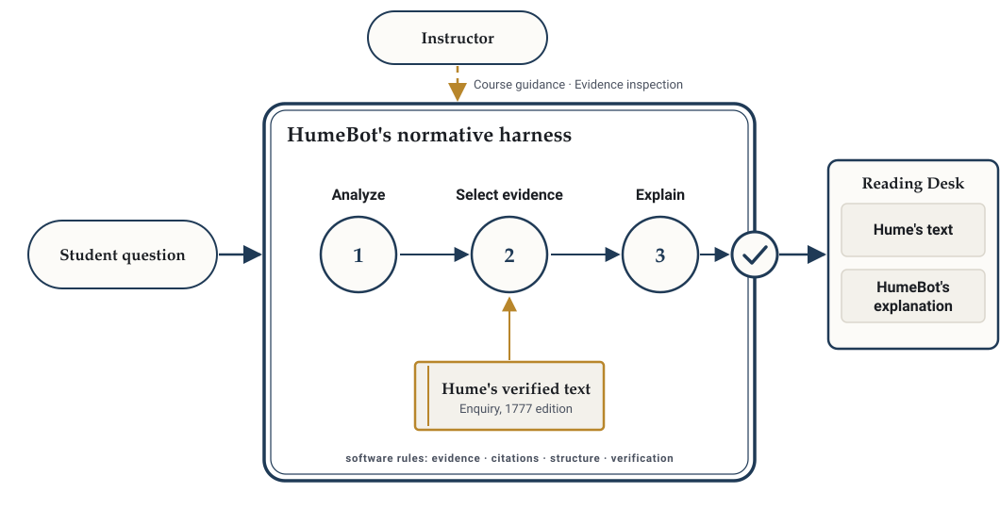

About this report

<dl>

<dt>Central question</dt><dd>Why build HumeBot rather than simply call a capable frontier model with a carefully designed prompt and the complete text of Hume's <em>Enquiry</em>? The answer runs through the epistemic norms of philosophical inquiry and what they require of an educational AI.</dd>

<dt>Audience</dt><dd>Philosophers, faculty, educational researchers and interested University colleagues. No technical background is assumed; the technical architecture is Report 1.</dd>

<dt>Evidence and scope</dt><dd>The project's constitutional document (its governing principle and eight normative invariants, as amended on 8 November 2026), its design rulings of September to November 2026, the typed response contract, the Reading Desk as implemented, and the record of the instructor-guidance studies. Experimental findings are mentioned only where the argument needs them; their methodology and limits are in Report 5.</dd>

<dt>Status</dt><dd>The principle and the invariants are adopted and implemented in a development prototype that is not deployed or approved for student use. No educational outcome has been evaluated with students.</dd>

</dl>

## Executive summary and the governing principle

HumeBot helps students investigate questions about David Hume's *Enquiry concerning Human Understanding*. A student asks a question; HumeBot answers it substantively, with its best-supported reading of the text, and presents that reading beside the passages of Hume it rests on, each verified against a controlled transcription of the 1777 edition. The activity it serves is historical-philosophical inquiry as it is practised in a philosophy course: reading a primary text closely, reconstructing its arguments, weighing competing interpretations, and reaching a judgment one can defend with reasons that others can examine.

The project's design follows one governing principle, adopted on 8 November 2026:

> Educational AI should be designed around the epistemic norms of the activity it is meant to support, rather than around a generic conception of a helpful conversational assistant.

The thesis of this report is the principle applied. For historical-philosophical inquiry, designing around the epistemic norms of the activity requires explanations accountable to the primary text, explicit philosophical reasoning that a reader can examine, pedagogy guided by the instructor rather than by a model's pretrained tendencies, and built-in opportunities for critical examination. HumeBot's architecture is the attempt to make those requirements structural.

The question this report is organized around is the one any reader of that principle should ask: **why build HumeBot at all, rather than simply call a capable frontier model with a carefully designed prompt and the complete text of the *Enquiry*?** Such a model can be asked to reconstruct arguments, quote exactly, cite correctly, preserve Hume's qualifications and explain where interpreters disagree, and it will often do all of this well; it can also be given the instructor's own notes. HumeBot denies none of that, and it can itself use a frontier model to generate its explanations. The contrast is not between a weak model and a strong one but between relying on a model's generated response alone and using a model inside a discipline-specific software harness. A norm that is requested in a prompt is not enforced: when the model fails it, nothing in the response tells the reader. Enforcement has to come from outside the generating process, and other applications could build it; HumeBot is one implemented, discipline-specific instance, in software the project calls the **normative harness**. The model generates the philosophical explanation; the harness governs the evidence, its provenance, the structure of the response and its verification. Every quotation a student sees is constructed by the software from the controlled text, at a location the student can check; every interpretive sentence is tied to specific words in the displayed evidence; what fails the checks is withheld; what the software has and has not verified is stated to the reader; and an instructor can inspect the evidence behind every answer. The project treats epistemic accountability as an architectural requirement because the activity's standards concern what a reader can check, and checkability has to be built, not promised.

<strong>Figure 1.</strong> The normative harness. The model generates the explanation; the harness governs the evidence and the verification. The instructor's guidance shapes the course and inspects the evidence; it is not an input to the model.

The report also keeps three things apart, because they are often run together: the **educational principle**, which is a normative claim about how such a tool should be designed; its **architectural implementation**, which is a matter of record and is described in Report 1; and the **educational outcomes**, which are empirical and remain to be established. The architecture can be shown to enforce what it enforces. Whether it helps students read Hume better is a question no study has yet answered.

Established, not established, open

<strong>Established.</strong> The governing principle and eight normative invariants are adopted as the project's constitution. Adoption is not implementation. The software enforces textual provenance, typed response structure, evidence anchoring and the auditability requirements: displayed text is built from the corpus and verified, interpretation is typed and anchored to displayed evidence, and an instructor can inspect the evidence behind every answer. Commitments that require curated scholarly content (attributed scholarship, contestation, voice, retraction) or pedagogical capabilities not yet built (response policies and profiles) remain partly or wholly unimplemented. In the project's own comparisons the harness delivered no faulty citation where the same model under direct prompting delivered many (Report 5).

<strong>Not established.</strong> That HumeBot's explanations are more faithful to Hume, or more useful to a student, than a well-prompted model given the same text; that any model's reasoning actually depends on the supplied text rather than on its training; and any effect on student learning. No classroom study has been conducted.

<strong>Open.</strong> How instructor-authored interpretive frameworks should relate to generation (currently: not at all); how contestation among interpretations should be represented when the scholarly substrate exists; what a classroom evaluation would measure; and how far the design generalizes beyond one text and one instructor.

## The educational problem

The strongest realistic alternative to HumeBot is not a careless chatbot. It is a capable frontier model, given the complete text of the *Enquiry*, prompted with care to reconstruct Hume's arguments, quote and cite exactly, preserve his qualifications, distinguish his assertions from the views he examines, and explain where interpreters disagree. Such a system can produce excellent philosophical explanations. It can use citations, primary texts and retrieval tools; it can be given an instructor's lecture notes and asked to follow them; and in the project's own small comparison, a blinded AI reviewer more often preferred a frontier model's direct explanations to those the same model produced inside HumeBot's harness, on pedagogical grounds (Report 5, §4). HumeBot has not demonstrated superior philosophical interpretation, and this report does not claim it.

The educational problem lies elsewhere. A plausible explanation is not the same thing as an accountable interpretation, and nothing on the surface of a generated response marks which it is. An accountable interpretation is a claim with visible grounds: it says what Hume wrote, where, and how the reading follows from the words, and it can be asked to show the passage, defend the inference and say what it leaves out. A generated explanation may have all of these virtues or none. Its citations may be real or not; its summary may preserve Hume's qualifications or quietly drop them; and the student who asked is checking against a text they are still learning to read, which is the very skill the course exists to teach. The point is not that students cannot check, but that a tool for this activity should make checking the natural next step rather than an act of suspicion.

That matters because helping a student understand a philosophical argument is not the same as giving the student a correct answer about it. Understanding, in this discipline, means being able to find the argument in the text, state its premises and inferences, see what it assumes, consider how it might be resisted, and arrive at a judgment one can defend. A tool that supplies the conclusion while bypassing the text can leave a student knowing *that* Hume denies a rational foundation to induction without being able to say *where* or *why*. The form of an assistant's reply, a question followed by a complete answer, does not by itself direct the student back to the text.

What HumeBot adds, then, is not a better explanation but a different relation between the explanation and its evidence. Precisely:

- **software-enforced textual provenance:** every displayed quotation is constructed from the controlled text, not written by the model;
- **deterministic verification of quotations and locations**, with anything that fails withheld rather than shown;
- **explicit separation of primary text from interpretation**, kept apart as distinct, labelled kinds of content;
- **sentence-level evidence accountability:** each interpretive sentence is tied to the specific words it rests on, which the reader can open;
- **instructor evidence inspection:** what was supplied, selected, displayed and cited, and what the checks found, for every answer;
- **a governed reading environment** in which students examine interpretations against the whole text and, in a development build, can challenge them.

A standalone model invocation can be *asked* for the first four and will often comply, but it does not provide independent enforcement of citation accuracy, textual provenance and response structure, because the only check is the one the generating process performs on itself. A frontier model connected to external verification tools could provide such enforcement; HumeBot's contribution is a particular implemented, discipline-specific normative harness of that kind, not a capability that no other AI application could build. One limitation runs the other way and should be stated plainly: an instructor's materials can be supplied directly to a frontier-model prompt today, whereas HumeBot's frozen generation pipeline does not incorporate them (section 6).

The project's design also responds to characteristic failures it has observed or anticipated in unharnessed model use on questions about Hume: citations that look right but do not contain the argument; the voices of the *Dialogues* flattened into "Hume's view"; positions Hume retracted restated as settled; scholars' constructs presented in Hume's name; contested interpretations delivered in the register of a textbook; and difficulty pointing a student to the paragraph they should read next. Some of these the current architecture addresses, through verified citation and the display of whole passages; others await a curated scholarly substrate that the project has specified but not built (section 4).

One measurement from the project's own work shows the difference between requesting a norm and enforcing it. With the same open-weight model, carefully prompted to quote and cite exactly and given the whole text of the *Enquiry*, 12 of 51 citations were faulty across 11 of 24 questions, and none was detected; inside the harness, the same model's 89 citations contained no fault, because the harness constructs every displayed quotation from the text and withholds what it cannot verify. The same study found no interpretive winner (Report 5, §2). The harness did not make the model more careful. It made the model's misquotations detectable, and refused to pass them on.

## The epistemic practices of historical philosophy

The governing principle directs design toward the epistemic norms of an activity. For the history of philosophy as taught in a course, those norms are embodied in a small number of practices, each of which asks something specific of any tool that would support it.

**Close reading.** Meaning in a philosophical text is carried by particular words in context. Whether Hume says that a principle *cannot* be justified, or that it is *not* justified by *reasoning*, or that we are *not determined by reason* to rely on it, makes a philosophical difference; so does whether a sentence is Hume's assertion, a view he reports in order to examine, an objection he raises against himself, or a concession. Close reading requires the words themselves, in their paragraph, in their section. A paraphrase, however accurate, is a different object. A tool that supports close reading must put the text in front of the student, whole, and must preserve distinctions of scope, modality and qualification rather than smoothing them away.

**Textual evidence.** Claims about what a philosopher holds are answerable to the text. A citation is evidence, not decoration: it says *look here*. It follows that a citation must be real, exact and locatable, and that the reader must be able to follow it to the passage and judge whether the passage says what the citing sentence needs. The practice presupposes a controlled text, a stable way of naming its parts, and the habit of checking.

**Argument reconstruction.** Philosophers read arguments by reconstructing them: identifying the conclusion, the premises stated and the premises assumed, and the inferential steps; asking what the argument needs that the text does not supply, and where it could be resisted. A reconstruction is an interpretive act, performed by someone, open to criticism and comparison with alternatives. Hume's argument about induction can be reconstructed in several defensible ways; which premises one makes explicit, and in what order, is a decision an interpreter takes and must own. A tool that supports reconstruction must make the structure of an interpretation visible as structure, and must attribute it.

**Competing interpretations.** Contestation is the normal condition of the discipline, not a failure of it. Whether Hume is a sceptic about induction or a naturalist describing how belief in fact arises, whether his two definitions of cause are meant as equivalent, whether his *Dialogues* speak in his own voice, are live questions with literatures behind them. A settled-sounding answer to a contested question misrepresents the state of knowledge and forecloses the student's own inquiry. A tool must be able to say that a question is contested, to attribute positions to those who hold them, and to decline to settle what the discipline has not settled.

**Qualifications, objections and critical assessment.** The student's task is to assess, not to receive. That requires seeing what an interpretation omits, what it assumes, and what in the text might count against it; and it requires that the student's objection be a legitimate move rather than a deviation from the answer. A tool that supports assessment must leave room for it, must make its own reading contestable, and must not present its output as the terminus of inquiry.

**Publicly examinable reasons.** Underlying all of these is a norm about authority. In philosophy, the authority of a reading is the argument for it, and the argument is public: anyone can examine the passages and the inferences and judge for themselves. Private conviction, however strong, and private process, however sophisticated, are not reasons. A tool that participates in the practice must offer reasons that can be examined as an argument, not reports of its own inner workings, and must not claim more authority than its grounds warrant.

**From practices to requirements.** Each practice yields a requirement on any tool that would take part in it: the text itself, whole and in context; citations that are real, exact and followable; interpretive structure that is visible and attributed; contestation acknowledged rather than settled by fiat; room for the student's objection; and reasons offered as an examinable argument rather than as the output of an authority. These are the discipline's requirements, and they do not by themselves dictate a software architecture. A carefully prompted model with the text at hand can pursue every one of them, and an instructor pursues them with no software at all. What distinguishes architectures is which requirements they make *independently enforceable and inspectable*, rather than dependent on the generator's compliance. HumeBot is one specific architectural response of that kind, not the uniquely correct one: it enforces provenance, authorized evidence, typed structure and sentence-level anchoring by construction, and leaves the rest, as any design must, to judgment. Table 1 sets the practices against HumeBot's response to each and against what still awaits a substrate.

One clarification belongs here. HumeBot's reading is interpretive prose, sentence by sentence, with each sentence linked to the words it cites. It does not implement a formal, machine-readable reconstruction of premises and inferences; an earlier research prototype of such a representation is paused and is separate from the application. Where this report speaks of making the structure of an interpretation visible, it means the articulation of a reading into sentences each shown with its evidence, not a formal argument structure.

<strong>Table 1.</strong> The practices of the discipline and HumeBot's design response to each.

| Practice | What it demands of a tool | HumeBot's response | Status |
|---|---|---|---|
| Close reading | The words themselves, whole and in context; distinctions of scope and modality preserved | Every cited passage displayed as its whole paragraph, with neighbours and the complete section; the response contract requires relevant distinctions to be preserved | Display implemented; preservation of distinctions is a requirement on the model, judged by readers, not enforced by software |
| Textual evidence | Real, exact, locatable citations the reader can follow | Displayed text constructed from the controlled corpus; every quotation and location verified; failures withheld | Implemented and enforced |
| Argument reconstruction | Structure made visible and attributed | HumeBot's reading is interpretive prose typed as interpretation, sentence by sentence, each sentence linked to the words it cites; instructor-authored reconstructions kept distinct and attributed | Sentence-level evidence links implemented; no formal argument structure is represented; instructor reconstructions are course artifacts outside the system (section 6) |
| Competing interpretations | Contestation stated; positions attributed; no false settlement | Scholarship typed and attributed; contestation metadata gates response shape; the core does not choose a stance on contested issues | Typing implemented; the scholarly register and contestation data are not yet populated |
| Objection and assessment | Room for the student's judgment; a contestable reading | Two verdicts per sentence (source verified; interpretation not verified as correct); a development build lets a course attach questions, objections and alternative interpretations | Verdicts implemented; the commons is a development build |
| Public reasons | Examinable argument, not inner process; no overclaiming | Reasoning must be offered as an argument and never represented as the model's internal reasoning; labels may not suggest that provenance establishes correctness | Normative requirement; the labels are implemented |

## The eight normative invariants

The project's commitments are stated as eight normative invariants, adopted by the faculty lead on 29 October 2026 and revised, with the eighth added, on 1 November 2026. Their standing is explicit: they hold because a scholarly instrument for reading Hume requires them, *not* because they have been shown to improve explanations, and their retention never depends on interpretive-quality or preference scores. If a required component turns out to cost quality, the cost is measured and reported, and reduced within the invariant, never by relaxing it. The governing principle explains and unifies the eight; it adds none. The first seven arise from the epistemic and pedagogical demands of the activity described above. The eighth has an independent ethical justification, and equal authority. Adopting an invariant is not the same as implementing it: the software today enforces textual provenance, typed response structure, evidence anchoring and the auditability requirements, while commitments that need curated scholarly content or pedagogical capabilities not yet built remain partly or wholly unimplemented, and each note below says which.

For each invariant the official formulation is given in full, in italics, followed by its rationale and a note on what the software enforces and what remains a normative or empirical objective.

<ol class="invariants">
<li>
<strong>Visible primary text.</strong> <em>A substantive verified explanation displays the relevant Hume passages as system-built, verified TEXT, and every READING support lies inside displayed TEXT. Citations attached to model prose are not a substitute. Abstentions, open-only responses, failure notices and the provisional fallback are not substantive verified explanations and never present themselves as one.</em>

Rationale: close reading needs the text, not a reference to it. A footnote asks the student to trust; a displayed paragraph lets the student check. Enforced in software: TEXT is constructed by the system from the corpus, and a reading sentence whose support lies outside displayed TEXT fails a gate. What counts as the <em>relevant</em> passages is the model's proposal and a reader's judgment.
</li>

<li>
<strong>Deterministic provenance.</strong> <em>Every displayed quotation and citation is derived from, or verified against, the controlled corpus through the canonical citation system before it reaches the reader; anything that fails verification is withheld (fail closed). Scholarship attributions must carry bibliographic identity from adjudicated cards; their substantive and attributional correctness remains subject to human review, and registry checks do not constitute bibliographic verification.</em>

Rationale: a citation that cannot be trusted is worse than none, because it borrows the authority of the text for whatever it is attached to. Enforced in software: exactness and location are checked deterministically, and failure withholds the answer. The correctness of a scholarly attribution is a matter for human review; the software checks only that the attribution comes from an adjudicated register, which is at present empty.
</li>

<li>
<strong>Epistemic typing.</strong> <em>TEXT, READING, SCHOLARSHIP and OPEN remain distinct. An anchored interpretation is not thereby verified as correct. Verification establishes the identity and location of textual evidence, not the philosophical adequacy of an interpretation. No label, score or presentation may suggest that verified provenance establishes an interpretation's correctness, or claim greater interpretive authority than the grounds warrant. Readers must be able to inspect the grounds offered for a reading.</em>

Rationale: the discipline's central distinction is between what the text says and what an interpreter makes of it; a tool that blurs it teaches the wrong habit. Enforced in software: the four types are structural, and prose cannot migrate between them. The prohibition on misleading presentation is a design discipline the project holds itself to, visible in the two verdicts shown for every sentence.
</li>

<li>
<strong>Evidence accountability.</strong> <em>Every interpretive claim must remain traceable to passages actually supplied to the generator and available for inspection. The presence of an exact quotation or citation does not establish that the passage supports the interpretation.</em>

<em>HumeBot must preserve relevant distinctions of scope, modality, argumentative force and epistemic qualification. It must distinguish what Hume asserts, entertains or qualifies from what HumeBot reconstructs.</em>

<em>The reasoning offered in an explanation must be intelligible and open to examination as an argument. It must not be represented as a report of the model's internal reasoning. Inferential sufficiency, epistemic calibration and philosophical adequacy remain standards for human evaluation; deterministic verification does not certify them.</em>

Rationale: public reasons. A reading earns assent by an argument the reader can follow from the passages, not by the standing of its author or the opacity of its process. Enforced in software: traceability (every cited unit belongs to the evidence actually supplied; every sentence is anchored). Normative and evaluative: the preservation of distinctions, the intelligibility of the argument, and its adequacy, which are judged by people.
</li>

<li>
<strong>Evidence-dependent reasoning.</strong> <em>Generation must be designed to engage controlled primary-text evidence rather than merely attach citations to explanations drawn from pretrained knowledge. This is an architecture-independent normative and behavioral requirement.</em>

<em>The corpus material supplied to the generator must be logged accurately and made available for appropriate inspection. Every READING sentence must be anchored in inspectable evidence. Displayed TEXT is constructed by the system from the controlled corpus, and quotations introduced by the model must be verified before delivery. The limitations of an answer must be represented honestly.</em>

<em>These mechanisms do not prove what internally influenced the model. Evidence exposure, citation validity and actual inferential support are distinct; whether a model's reasoning actually depends on the text is a behavioural objective, evaluated empirically and never claimed.</em>

<em>For the existing frozen architecture, the selected-evidence-only requirement remains binding under R39, R42 and contract 0.7. A successor architecture requires separately authorized changes or a bounded research exception.</em>

Rationale: an explanation decorated with citations after the fact is the educational problem of section 2 in a more respectable form. Enforced in software: the explaining stage receives only the selected evidence (the "selected-evidence-only requirement"; R39 and R42 are project rulings and contract 0.7 the response contract); what it received is logged; its quotations are verified. Empirical objective, never claimed: that the model's reasoning actually depended on that evidence. The project states plainly that it cannot establish this, and treats it as a question for study.
</li>

<li>
<strong>Instructor authority.</strong> <em>The instructor determines pedagogical objectives and approved norms of engagement with primary texts. Pedagogical behaviour, however produced, belongs to a profile or response policy the instructor can set or decline, never to the mode-neutral core.</em>

<em>Instructors may exercise this authority through course design, evidential standards, approved response policies or optional profiles. Instructor authority does not itself require a particular runtime configuration feature.</em>

<em>No instructor policy or profile may override provenance, source integrity, source separation, privacy or auditability.</em>

Rationale: pedagogy is a matter of judgment about a particular course and its students; a core that embedded one pedagogy would impose it on every course, and a model left to its defaults would impose an unattributed one. Enforced in software: the core contains no pedagogy, and the instructor's course controls cannot touch verification, provenance, privacy or audit. Normative: the framework of policies and profiles, none of which yet exists (section 6).
</li>

<li>
<strong>Educator auditability.</strong> The constitution states this invariant by reference to its paragraph on auditability, which reads in full: <em>Educator-facing auditability is part of HumeBot's academic purpose, not a workaround for model limitations. For any response an instructor must be able to inspect, as an evidence sheet, what evidence was supplied, selected, displayed and anchored, the verification and gate results, the interpretive limits shown, and the relevant generation metadata (model, prompt versions, settings). "Anchored" records which passages each sentence cites, not what the model internally relied on. Development traces exist, and Reading Desk 1.0.0-rc1 includes an instructor Evidence Inspector over synthetic sessions, recorded responses and live-generated answers; the formal evidence-sheet exporter is not yet built. Neither that development view nor any other application surface is authorized for real student data before SD-1. Auditability never overrides student privacy: no real student data reaches a remote provider or an instructor view before the SD-1 determination.</em>

Rationale: the instructor is responsible for what students are taught, and cannot discharge that responsibility over a system whose workings are hidden. Implemented: the Reading Desk's Evidence Inspector shows all of this for every answer; a formal exportable evidence sheet is not yet built.
</li>

<li>
<strong>Student privacy and data separation.</strong> <em>No real student uses HumeBot, and no real student data reaches a remote provider or an instructor view, before the SD-1 determination. Instructional data, operational telemetry, research data and post-training data stay separate. Storing an interaction gives no permission to analyse, reuse or train on it; any such use goes through the appropriate institutional consent and governance pathway. Auditability never overrides student privacy.</em>

Rationale: this invariant does not follow from the epistemology of reading Hume. It follows from what is owed to students as persons whose questions, confusions and half-formed readings are part of their education and not a resource. The project gives it equal governing authority with the other seven, and makes it a limit on them: auditability, however valuable, stops where privacy begins. Enforced in software: student use is refused by configuration until a written determination exists, the application admits synthetic identities by default, the research schema is created empty and never written, and logs carry no question text. Governance: the consent and institutional pathway, which is not the project's to design.
</li>
</ol>

Two further commitments of the constitution are worth naming here because they are often mistaken for features. **Voice tracking** (that a statement by Cleanthes or Philo is never presented as Hume's) and **retraction surfacing** (that the Appendix's second thoughts appear whenever the bundle theory does) are adopted commitments without a substrate: the *Dialogues* and the *Treatise* are not in the corpus, and the curated data that would carry dialectical roles within the *Enquiry* does not yet exist. The project records them as commitments, says they are not operational, and does not claim them.

## Evidence, interpretation and public justification

The heart of HumeBot's design is a distinction that is easy to state and easy to lose: between an **accurate citation** and a **correct interpretation**.

An accurate citation is a matter of fact about a text. Either the words appear at the place named or they do not; either the passage is in the authorized evidence or it is not; either the sentence is tied to specific words or it floats free. These are the things the harness verifies, deterministically, for every answer, and the record of that verification is strong: in the project's studies the harness's constructed citations were exact in every case checked, for example all 238 in a 60-question held-out study with an open-weight model and all 442 in a 20-question comparison with a frontier model (Report 5, §3). A correct interpretation is a matter of philosophical judgment. Does the passage support the sentence that cites it? Is the reconstruction faithful to the argument's structure? Has a qualification been dropped, a hedge turned into an assertion, a counter-passage overlooked? Is the explanation adequate for the student who asked? No deterministic check can answer these questions, and the project's constitution forbids any label, score or presentation that implies otherwise.

The two come apart in both directions. A sentence can cite exactly and misread: it can quote Hume's words on custom and draw from them a conclusion Hume does not draw. And a sentence can read well and cite badly, as the prompted model in section 2 did. Verification therefore establishes something real and limited: that the evidence is what it says it is and is where it says it is. The project's phrase is that **an anchor locates the evidence to check; it does not license the interpretation.** That is why the Reading Desk gives every sentence two verdicts rather than one: *source and location verified*, and *interpretation not verified as correct*. The second is not an apology. It is the point. It hands the student the materials for the judgment that is theirs to make, and refuses to make it for them under the appearance of having checked.

This is where the norm of public justification does its work. The project asks HumeBot for reasons that can be examined as an argument, and it declines to ask for, or to represent, the model's private reasoning. The distinction is principled. A language model's internal process is not available for inspection, and a transcript of its deliberation, were one produced, would itself be generated text whose relation to the causes of the output could not be verified. The project's constitution is explicit that it cannot establish whether a model relied on the supplied passages or on its training: evidence exposure, citation validity and actual inferential support are three different things, and only the first two can be checked. What *can* be made public is the justificatory structure of a reading: these passages, cited at these words, offered as grounds for these sentences. That structure is what philosophy has always required of an interpretation, from any interpreter, human or otherwise.

Publicly examinable reasons change what a student can do. With HumeBot's reading beside Hume's text, a student can **inspect the passages**, whole and in their section, rather than take the summary on trust; can **reconstruct the reasoning**, seeing which words each step rests on and judging whether they bear the weight; can **challenge the interpretation**, by finding a passage it slights or a qualification it drops; and can **consider omitted evidence**, since the surrounding paragraphs and the complete section are there to be read, so that evidence the reading does not cite can be sought where it would be found; the instructor's Evidence Inspector adds a view of what was supplied and selected but not displayed. In a development build of the Reading Desk, a course can go further: a reader may share a verified reading with classmates, who attach questions, objections and alternative interpretations to its sentences or to Hume's paragraphs, with every contribution attributed and none ranked. HumeBot's reading is designed to be a **contestable artifact**: an interpretation with an author, grounds and a place in a conversation, not an oracle.

Two further features belong to the same norm. When the evidence does not settle a requirement the question raises, the response says so, in a type (OPEN) that carries no model prose: HumeBot abstains in the open rather than filling the gap fluently. And when a question reaches beyond the corpus, the statement of that limit is made by the software from approved scope metadata, not by the model, so that the boundary of what HumeBot can speak to is itself a matter of record rather than of the model's self-assessment. On genuinely contested questions the project's rule is that HumeBot's core does not choose a stance; attributed scholarly positions, when the curated register exists, will be typed as scholarship and never blended into Hume's text or HumeBot's reading.

## Instructor-guided pedagogy

A course is not a collection of answers. It is a sequence of readings, distinctions, problems and tasks chosen by someone who has decided what matters, in what order, and why; and its intellectual framework, the way this course reads Hume, is set in lectures, notes, handouts, assignments and conversation. When a general-purpose assistant answers a student's question without course-specific guidance and governance, it may determine the interpretive emphases itself: which passages are treated as central, which reading is presented as the natural one, how settled a contested question is made to sound. Those choices are then made without attribution to anyone and without oversight by the person responsible for the course. The project's position is that leaving such choices to a model's defaults delegates a consequential part of teaching, and that the instructor's framework should govern the course even when the course uses an AI.

It is important to be exact about what this does and does not mean in HumeBot today. Three things must be distinguished (Table 2).

<strong>Table 2.</strong> Three layers of instructor authority, and their status.

| Layer | What it is | Status |
|---|---|---|
| The instructor's existing authority over the course | Lectures, notes, distinctions, argument reconstructions, assignments and objectives: the framework within which students use any tool | Exercised through the course itself, outside the system; the project's design is built to respect it, not to replace it |
| Implemented controls and oversight | In the Reading Desk, the instructor decides whether students may ask new questions and sets the default reading view; in a development build, whether readings may be shared, and moderates contributions; for every answer, the instructor can inspect the evidence, verification and history | Implemented in the development prototype; these are controls over use and oversight, not over the model's interpretations |
| Instructor-authored frameworks in generation | Supplying an instructor's reconstruction or objectives to the model so that HumeBot's explanations follow the course's reading | **Not implemented.** Studied in November 2026 under a bounded research exception; the faculty lead decided that instructor materials are, for now, to be presented as distinct, attributed course artifacts beside Hume's text and HumeBot's readings, and that generation using them is not authorized. The presentation feature is itself not yet built |

The first layer is why the project abandoned an earlier plan for a "tutor" persona: in the primary setting, the instructor already supplies the pedagogy, and a persona that competed with it would be solving the wrong problem. The second layer is deliberately narrow. The instructor's controls cannot affect verification, provenance, privacy or audit, because the invariants are not the instructor's to waive; and they do not reach into the model's interpretations, because the project has not yet decided how an instructor's framework should relate to generation. This is also the point at which the frontier-model alternative currently has a capability HumeBot lacks: an instructor's notes can be placed in a model's prompt today, whereas HumeBot's frozen pipeline receives only the question, the corpus and its own analysis.

The third layer is where the design question lives. The project's research planning contains a working view, **an unadopted research proposal and not constitutional policy**, that an instructor's reconstruction has *curricular* authority without interpretive infallibility: it settles what the course teaches and in what order, while remaining answerable to the text and open to a student's challenge. On that view a course reconstruction would always travel with its attribution and its provisional status; the word *verified* would belong to passages, never to readings, the instructor's included; and the chief risk to guard against would be amplification, a system repeating a course reading fluently beside verified passages and so spreading its errors as readily as its insights. None of this is implemented or adopted.

Whether supplying such a framework to the model actually improves explanations was tested in three small studies in November 2026, on development material and under a bounded exception to the rule that the explaining stage sees only selected evidence. Instructor guidance influenced the framing, attribution, form and task formation of the explanations; it did not produce a reliable improvement, and in one condition the longer, guided answers were more often withheld at the length limits (Report 5, §6). The faculty lead closed the line with a decision: **display only, for now.** Instructor-authored materials are to be shown as distinct, attributed course artifacts beside Hume's text and HumeBot's readings; generation using them is not authorized; and research on instructor records shaping model behaviour is a major future programme, not a prerequisite for the application. The project does not present instructor notes as controlling the model's output, because they do not, and it does not present instructor-authored pedagogical policy as an implemented layer of the system, because none exists.

One design principle of the project bears directly on why. Its working convention is that **rules are for invariants and cases are for evaluation**: explicit software rules are added only for domain-general epistemic and structural requirements, such as exact quotation, valid locators and source boundaries, while question-specific substantive reasoning, which distinctions matter, how many steps an argument needs, where an explanation should stop, is left to judgment under general norms and tested against reviewed cases. An instructor's framework is substantive reasoning of exactly that kind. Encoding it as rules in the core would be both a category error and a breach of mode neutrality; the open question is what form, short of rules, would let a course's reading inform HumeBot's explanations faithfully. The project has not answered it.

## Case study: Hume's problem of induction

The relationship among Hume's text, an instructor's reconstruction and HumeBot's interpretation can be seen in the case the project's public demonstration uses: the problem of induction in Sections IV and V of the *Enquiry*. Three contributions meet around a student's question, and the design keeps them apart.

**Hume's text.** The passages below are built from the controlled corpus of the 1777 edition, at locations a reader can check.

> "All inferences from experience suppose, as their foundation, that the future will resemble the past, and that similar powers will be conjoined with similar sensible qualities." — EHU 4.21

> "To endeavour, therefore, the proof of this last supposition by probable arguments, or arguments regarding existence, must be evidently going in a circle, and taking that for granted, which is the very point in question." — EHU 4.19

> "This principle is CUSTOM or HABIT. For wherever the repetition of any particular act or operation produces a propensity to renew the same act or operation, without being impelled by any reasoning or process of the understanding …" — EHU 5.5

**The instructor's reconstruction.** What follows is an instructor-authored pedagogical reconstruction, in the instructor's own terms. It is not Hume's wording and not the uniquely authoritative reading of Hume; it is the framework within which one course approaches the argument, offered for comparison with the text and open to criticism.

Instructor-authored reconstruction · the sunrise inference

<strong>Past experience (PE).</strong> The sun has risen on every day in our past experience.

<strong>Future expectation (FE).</strong> The sun will rise tomorrow.

The step from PE to FE is not a deductive one: that the sun has always risen does not entail that it will rise again. The inference needs a connecting principle.

<strong>The Uniformity Principle (UP), the missing premise.</strong> The future will resemble the past in the relevant respects.

<strong>Hume's challenge.</strong> What justifies UP? Appealing to past experience to justify the Uniformity Principle already assumes that past experience is a reliable guide to unobserved cases, which is UP itself; to justify UP by experience is to argue in a circle (EHU 4.19).

The instructor's fuller reconstruction also names the present impression from which an expectation starts; this simplified version sets it aside because it does not bear on the question of justification.

*A note on Hume's argument, offered by this report and not part of the instructor's reconstruction.* Hume's own argument in Section IV, Part II is broader than the reconstruction needs to show. He first distinguishes demonstrative reasoning from reasoning concerning matter of fact, and argues that no demonstrative argument can establish that the future will resemble the past, since a change in the course of nature implies no contradiction and can be distinctly conceived (EHU 4.18); only then does he turn to arguments from experience and find the circle the reconstruction identifies (EHU 4.19–4.21). Hume's negative conclusion is that no reasoning supplies the missing premise; his positive account, in Section V, is that what carries us from past to future is custom or habit, a principle of human nature rather than an argument (EHU 5.5). The reconstruction's concentration on the circularity is a pedagogical choice about where to place the emphasis, and one of the things a student can ask is what the fuller argument adds.

**HumeBot's interpretation.** In the Reading Desk, HumeBot's answer to a student's question on this topic appears as a sequence of interpretive sentences, each citing the passages it rests on, beside those passages displayed whole. One such sentence, taken from a development answer generated by the model from selected passages and verified for provenance, not for correctness (a development record from the project's research files; it is not presented here as one of the demonstration answers bundled with the Reading Desk), reads: "The circle is this: any probable argument for the future's resembling the past would itself rest on that resemblance as its supposition, so it would assume the very conclusion it was meant to prove" (citing EHU 4.19 and 4.21). The student sees that the words it rests on are Hume's and are where the sentence says they are; the student is told, in the same panel, that whether the sentence reads those words rightly has not been verified.

**The educational relationship.** The three contributions do different work, and the design makes the differences visible. Hume's text is the evidence, and the only thing the software can verify. The instructor's reconstruction supplies the course's framework: it makes the inference explicit, names the missing premise, and tells the student where the philosophical pressure falls. HumeBot's interpretation is a third voice, model-generated and provisional, that the student can set against both. A student working with all three can ask whether HumeBot's sentence about the circle says the same thing as the instructor's UP step or something subtly different; whether Hume's own words at 4.21 state a premise or describe a presupposition; what the simplified reconstruction leaves out, and whether it matters; and whether the move from the negative conclusion to custom in Section V is the only way to read the transition. None of these questions is answered by verification. All of them are made askable by it.

Where the instructor's framework stands today is as the demonstration states: it is shown as a distinct, attributed contribution beside Hume's verified text and HumeBot's independently generated explanation. It has not been incorporated into the model's prompts, training or generation, and the pipeline that writes HumeBot's answers is instructor-agnostic. Presenting instructor materials inside the Reading Desk is a development direction, not a feature of the current application.

## Implications and unresolved educational questions

If the argument of this report is right, the architecture may support philosophical inquiry in several ways: by making the habit of checking the text the path of least resistance rather than an extra step; by presenting interpretation as structure that can be examined and contested rather than as a conclusion to be accepted; by keeping the instructor's framework, Hume's words and the model's reading visibly distinct so that a student learns to ask of any claim *whose* it is and *what* it rests on; and by giving the instructor sight of what the system did. These are design arguments, and the project holds them as such.

The evidence for them is proportionate and must be stated proportionately. What has been demonstrated is provenance: the harness delivers exact, located citations where direct prompting of the same models did not, and it does so by construction (Report 5, §3). What has not been demonstrated is interpretive or pedagogical superiority. In the project's small frontier-model comparison the harness did not improve fidelity to Hume over direct prompting of the same model with the same text, and a blinded AI reviewer more often preferred the direct form of explanation on pedagogical grounds, with answer length confounded and the judgments those of an AI reader rather than of a philosopher (Report 5, §4). The project's own convention anticipates this: epistemic constraint is not evidence of interpretive benefit, and a normatively required component that costs quality stays, with the cost reported. **No improvement in student learning has been demonstrated.** No student has used the application, and no classroom study has been conducted.

A classroom evaluation, when the institutional conditions for one exist, would need to examine at least the following. Whether students who work with HumeBot's text-beside-reading design actually check passages more, and read more of the section, than students given a conventional assistant or a bare text, and whether that checking changes what they write. Whether the capacity for independent argument reconstruction develops differently when students work with visible, contestable reconstructions, and whether a student should attempt a reconstruction before or after seeing the instructor's. Whether the two-verdict presentation is understood as intended, or read as a disclaimer and ignored. What the instructor's time costs, in review and in authoring course artifacts, and whether they are acceptable. Whether the design helps or hinders students with different levels of preparation and different access needs. And whether an instructor's framework, once some way of presenting or using it exists, improves the faithfulness of students' readings or merely their conformity. Any such study would be research, and would require the institutional review and consent that ordinary instructional use does not; the project's governance keeps the two apart.

Several design questions also remain open. How an instructor's reconstruction should exist as a contestable artifact in the system, with claim-level identity, visible status and a revision history, is undecided and deliberately not built ahead of a first worked case. How contestation among scholarly interpretations should be represented and gated awaits the curated substrate. Whether response policies or optional profiles are the right form for pedagogical behaviour, and what the first one would look like, is open. And the project's conceptual comparison with a different design, a Socratic tutor that restricts answer-giving to protect a student's own reasoning, remains a comparison only: it shows that different teaching aims warrant different epistemic constraints, and that HumeBot's choice to answer substantively, and to govern how its answers are justified, is one defensible design among several, not the only one.

## Conclusion {: .unnumbered }

Why build HumeBot rather than call a frontier model with a careful prompt and the whole *Enquiry*? Not because HumeBot explains Hume better. It has not been shown to, and in the project's own small comparisons the same frontier model, prompted directly, was sometimes preferred. HumeBot's contribution is an architecture that makes a model's explanations accountable to the epistemic standards of historical-philosophical inquiry: every quotation constructed from the text and verified, every interpretive sentence tied to the words it rests on, text and interpretation kept visibly apart, failures withheld rather than delivered, and the whole open to an instructor's inspection and a student's challenge. A prompt can ask a model for these things; a harness enforces the ones that can be enforced and says which ones it cannot.

That answer runs in three steps that should not be collapsed. The **normative justification** is the governing principle applied: an educational AI should be designed around the epistemic norms of the activity it serves, and for historical-philosophical inquiry those norms require accountability to the primary text, examinable reasoning, instructor-guided pedagogy and room for critical assessment. The **architectural properties actually implemented** are a matter of record: exact provenance, authorized evidence, typed and anchored interpretation, withheld failures and educator auditability, together with the plain statement that the software does not and cannot verify that an interpretation is correct, and with the instructor's framework kept outside generation pending a decision about how it should enter. The **educational benefits remain hypotheses**: whether a student who reads Hume with HumeBot understands Hume better, or learns to read philosophy better, is a question the project has designed itself to be able to ask honestly, and has not yet asked. No improvement in student learning has been demonstrated. The design's claim is more modest and more defensible than a claim of effectiveness: that if an AI is to take part in teaching students to read a philosopher, it should be held to the same standards of evidence and public reason that the discipline holds its students to, and that those standards can be built into the instrument rather than left to its good behaviour.

## Sources and document status {: .unnumbered }

<ul class="sources">
<li>HumeBot constitutional document: §1 (what HumeBot is), §3 (the governing educational principle, adopted 8 November 2026; the eight normative invariants, adopted 29 October and revised 1 November 2026; citation discipline, source typing, provisional fallback, voice tracking, contestation, retraction surfacing, mode-neutral core, auditability), §4 (working conventions: epistemic constraint is not evidence of interpretive benefit; rules are for invariants, cases are for evaluation).</li>
<li>Strategic directions: §13 (the product architecture reset of 13 September 2026 and why the tutor roadmap was superseded), §15.6 (closure of the instructor-guidance research arc, 5 November 2026), §16 (text-grounded question answering and the activity HumeBot serves, rulings of 30 October 2026), §17 (the governing principle).</li>
<li>Pedagogical concept memo (outline): the failure-mode analysis and the harm-reduction framing; auditability and verifiability as educational values.</li>
<li>HumeBot typed response contract (version 0.7) and the Reading Desk documentation (release candidate 1.0.0-rc1; course reading commons development build).</li>
<li>The instructor-guided induction pilot, the instructor-guided reconstruction test and the instructor-directed task-formation study (November 2026) and their closure note; see Report 5.</li>
<li>The HumeBot public demonstration page: the instructor-authored induction framework and the verified passages EHU 4.19, 4.21 and 5.5 (approved text, November 2026).</li>
<li>Research-planning drafts on instructor-directed inquiry (November 2026), cited for the project's working view on instructor reconstructions, which is not adopted policy.</li>
</ul>

<strong>Document status.</strong> Version 1.0, 8 November 2026. A faculty-led project report of the University of Minnesota Morris; not an official University publication and not University policy. HumeBot is a development prototype: not deployed, not approved for student use, and not qualified; no educational outcome has been evaluated.

