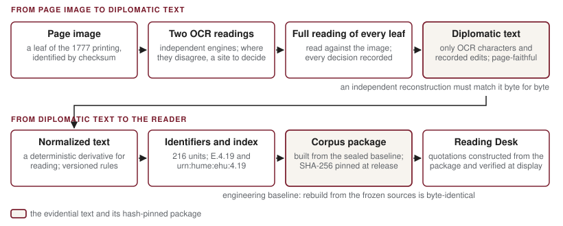

About this report

<dl>

<dt>Central question</dt><dd>How does HumeBot establish, verify and use Hume's primary text as the foundation for accountable philosophical interpretation?</dd>

<dt>Audience</dt><dd>Philosophers, textual scholars, digital-humanities researchers and developers of scholarly AI systems. Report 1 describes the application built on the corpus, Report 2 the educational argument, Report 5 the experiments.</dd>

<dt>Evidence and scope</dt><dd>The project's corpus standards and copy-text decision (August 2026), the provenance manifest, the production records of the transcription batches, the sealed engineering baseline of 19 August 2026, the citation index and corpus package, the earlier argument catalog, the scholarly sidecar specification, and the project's retrieval and graph governance documents. Figures were verified against the repository on 8 November 2026.</dd>

<dt>Status</dt><dd>The pilot corpus of <em>Enquiry</em> Sections I–IX exists, is sealed as an engineering baseline and is in use. It is not a canonical scholarly release, its scan source is provisional, Sections X–XII are not transcribed, and no curated scholarly annotation exists yet.</dd>

</dl>

## Why a controlled text

An AI application cannot reliably quote Hume without a controlled text. A language model's knowledge of the *Enquiry* is a statistical impression of many printings, editions, paraphrases and quotations; it will often reproduce a sentence correctly and sometimes produce one Hume never wrote, with nothing to mark the difference. In the project's own comparison, the same capable model that produced no faulty citations inside HumeBot's harness produced, when carefully prompted and given the whole text, twelve faulty citations in fifty-one, none of them detectable from the response (Report 5). HumeBot's requirement is stronger than accuracy on average: every quotation a student sees must be constructed from a known text and checkable against it, and every citation must resolve to a place in that text. That requires a transcription whose source is identified, whose production is recorded, and whose every unit has a stable name. The **corpus** is that transcription, and it is the foundation on which the rest of the application rests.

This report explains how the corpus was made and what it does. The copy-text is the 1777 edition of the *Enquiry concerning Human Understanding*, as printed in *Essays and Treatises on Several Subjects*, transcribed from page images by a recorded method: two independent machine readings of every page, a full reading of every leaf against the image with every decision recorded, and an assembly that an independent program reproduces byte for byte. The result is 216 citable textual units for Sections I–IX, in a page-faithful layer and a normalized layer, each unit carrying a stable identifier and a citation URI, and all but two a reference to its leaf and printed page, sealed on 19 August 2026 as the engineering baseline `determinism-baseline-5` and carried into the application as a hash-pinned package from which every displayed quotation is built and verified.

Two distinctions organize everything that follows. The first is between an **engineering baseline** and a **canonical release**. The baseline is sealed, reproducible and in use; the canonical release, a scholarly declaration that the text is complete and its sources fully settled, has not been authorized, for reasons given in section 4. The project's own rule is: *the pilot corpus is complete; the Enquiry is not; and the text is an engineering baseline, not a canonical release.* The second distinction is between what the corpus lets software verify and what it does not. Software can establish that a displayed quotation is textually exact and that its citation resolves to the right place. Whether the passage supports a philosophical interpretation is a judgment no corpus can make for a reader, and the application says so (section 5, Table 3).

Accomplished, incomplete, proposed

<strong>Accomplished.</strong> A controlled transcription of <em>Enquiry</em> I–IX from the 1777 printing, with recorded provenance to the page image for 214 of its 216 units, in two text layers, sealed as a reproducible engineering baseline and in use in the application.

<strong>Incomplete.</strong> The canonical release; the canonical status of the scan source; a second validation phase for five of the nine sections; Sections X–XII; the consolidation of provenance records for the sections produced after the pilot.

<strong>Proposed or specified, not built.</strong> Curated scholarly annotation (the sidecar: roles, relations, interpretation and contestation cards) has a specification and no content; the earlier argument catalog is a research artifact outside the application; retrieval indexes and graph structures are governed proposals; a student digital edition is an approved direction, not approved work.

## The copy-text and the move to independent transcription

### The 1777 edition

The project's copy-text for the *Enquiry* is the posthumous 1777 edition, in volume 2 of *Essays and Treatises on Several Subjects*, which incorporates Hume's last corrections. The decision, taken by the faculty lead on 18 August 2026, rests on a stated principle: the copy-text is the edition chosen for textual authority; the standard reference systems that scholars cite, the Selby-Bigge pagination and the field's paragraph numbering, are concordances attached to the copy-text in separate passes, never reasons for choosing it. The 1772 edition, the last Hume personally saw through the press, was recorded as a respectable alternative not chosen, and a 1772 concordance remains possible. Selby-Bigge's edition serves only as the source of SBN page references, never as text. The same decision adopts copy-texts for Hume's other works should the corpus ever extend to them; none of those texts exists in the corpus today.

### Hume Texts Online and the decision to transcribe independently

The project's first version, in April 2026, took its text from Hume Texts Online (davidhume.org), edited by Amyas Merivale and Peter Millican, fetching it at build time and never committing it to the project's repository. Merivale's personal permission was generous: the project was, in his words, "more than welcome to use these texts however you like — just an acknowledgement somewhere would be nice." The site's public terms are narrower, permitting reproduction for personal and educational purposes with attribution, and the project's own records treated the editorial work as acknowledged rather than licensed for further use.

In August 2026 the project decided to rebuild its corpus from public-domain page images. Its decision record is explicit that this was not a response to any refusal, actual or anticipated. The reasons were that a personal generosity should not be made to bear institutional or commercial weight; that a text built from public-domain printings with documented, checksummed provenance answers any future question about rights directly; that a pipeline for constructing a corpus from printed pages would be needed for any other author in any case; and that a tool whose thesis is verifiability should be verifiable all the way down, to the page. The record describes the result as converting a dependency into an option and closing nothing.

The intellectual debt and the source of the transcription are distinct, and the project keeps them so. The present text was transcribed from the 1777 page images, not from Hume Texts Online. But the 1777 edition is also that project's copy-text; HumeBot's paragraph identifiers follow the field-standard numbering that Hume Texts Online also uses; and the citations the project inherited from its earlier work were keyed to that numbering. The project acknowledges Hume Texts Online and its editors for the scholarship that informed its work and for the earlier use of their texts, and records that this permission is not the legal foundation of the present corpus.

## How the text was produced

The aim of the production method is a text whose every character has a recorded origin that anyone can check: either a machine reading of an identified page image, or a recorded decision about such a reading. Figure 1 shows the steps; each is described below with its purpose before its mechanics.

<strong>Figure 1.</strong> From page image to verified displayed text. The shaded boxes are the evidential text and the hash-pinned package built from it.

**Page images.** Each leaf of the source digitization is identified by its SHA-256 checksum and mapped to its printed page; the batch records state the mapping as a rule for their range (in the first production batch, the leaf number is the printed page plus seven throughout the body). Image files are never committed to the repository; they are identified by checksum and locator, so that a reading can always be traced to the exact image it was made from.

**Two independent machine readings.** Every leaf was read by two optical-character-recognition engines with different designs: Apple's Vision text recognizer, run in its accurate mode with language correction disabled on the full-resolution leaf, and Tesseract 5.5, run on a prepared derivative. The point of using two is that they make different mistakes; where they disagree, something needs a decision. The project's standard is emphatic about the limit of this: **the comparison of the two readings is a candidate-site finder, not a verifier.** Agreement between two engines proves nothing, and the page image alone is the arbiter of what the text says.

**A full reading of every leaf, with every decision recorded.** Because two engines can agree on the same error, the standard requires that every leaf be read in full against the page image, not merely at the sites the comparison flagged. The first production batch shows why: its verification report records 133 corrections to the chosen machine reading across 30 leaves, 23 of them at places the two engines had agreed on and only the full reading caught. Each leaf has a decisions record stating that the full reading was done and listing every edit with its line, the text found, the text substituted, its class, its verdict and a justification, together with the leaf and printed-page numbers and the checksums of the scan and of both machine readings. The reading and the decisions were made by an AI assistant working from the page image, under a documented workflow that confines it to adjudicating readings against the image and forbids it from acting as a transcriber; sites it could not resolve were to be put to the faculty lead as a compact question with the page shown, and in the two production batches no site remained unresolved. A separate audit of the long s (the eighteenth-century ſ, which machines often read as f) confirms that the image, not a word list, decided each case.

**Assembly, and an independent check.** The text is not typed. An assembler emits characters only from the machine-reading files and the recorded edits, so that every character traces to one or the other. A second program then reconstructs the text with its own logic, never calling the assembler, and requires byte-for-byte equality. A build that could not be reproduced this way would not be accepted.

**Two layers.** The result of assembly is the **diplomatic text**: the page-faithful transcription, keeping the long ſ, the ligatures and the line structure of the printing, and serving as the evidential source of truth. From it alone, by enumerated and versioned rules, a **normalized text** is derived for reading, searching and display: ſ becomes s, ligatures are expanded, line-end hyphenation is joined, page furniture is removed with page markers kept inline, and typographic emphasis is not carried. Because the derivation is deterministic, the two layers never drift apart. Corrections follow a two-class rule: where the transcription misread the page, the correction is applied to the text; where the page itself is thought to be in error, the printing's reading stays in the text and the editorial judgment is recorded as an overlay, visible as a judgment.

**What this establishes, and what it does not.** The method establishes that the diplomatic text is a recorded reading of an identified page image, that every departure from the machine readings is documented, and that the assembled text can be reproduced exactly from its sources. It does not establish textual-critical completeness. The project's standard says plainly that reproducibility of the build does not make the scanning, the machine reading or the adjudication themselves reproducible: another reader of the same page might decide a site differently, which is why every decision is recorded with its reasons. And the text has not been collated against other copies of the 1777 printing or against other editions. It is a carefully recorded transcription of one printing, not a critical edition.

## The corpus today

### Contents

The pilot corpus is *Enquiry* Sections I–IX: **216 citable units** (Table 1), of which 150 are main-text paragraphs and 66 are notes, parts of notes and headings, each a first-class documentary unit of the printed text. Treating notes and their parts as units means that a citation to a footnote is as precise as a citation to a paragraph. Of the 216 units, 214 carry references to the leaf and printed page they were read from; the two exceptions are cross-reference notes of 13 and 19 characters in Section III that share a printed line with a neighbouring unit.

<strong>Table 1.</strong> The 216 textual units of the pilot corpus, by kind.

| Kind of unit | Count |
|---|---|
| Main-text paragraph | 150 |
| Footnote, as a unit | 15 |
| Paragraph within a multi-paragraph note | 19 |
| Note cue in the text, and note head | 8 + 8 |
| Part heading within a section | 6 |
| Section heading, section title, section-level note | 5 + 4 + 1 |

### How the nine sections were produced

The sections did not arrive by one route (Table 2). Section II came first, as the pilot of the method, and was frozen on 18 August 2026 as a release candidate; it is the only section with a full entry in the provenance manifest. Sections I, IV and V were produced in a scale test of the pipeline and form the baseline's verified cohort. Sections III, VI and VII, and then VIII and IX, were produced in two production batches of 30 and 35 leaves by the method of section 3, with no unresolved sites; the baseline records them as *provisional production*, a term that refers to the status of the scan source and to a deferred second validation phase, not to the care with which the leaves were read. Sections X, XI and XII are not yet in the corpus (section 4.3).

<strong>Table 2.</strong> The nine sections, how each was produced, and its standing in the sealed baseline.

| Sections | How produced | Standing |
|---|---|---|
| II | Pilot of the method; release candidate frozen 18 August 2026 | Sealed release candidate; full manifest entry |
| I, IV, V | Scale test of the pipeline; V corrected at the baseline | Verified cohort |
| III, VI, VII, VIII, IX | Production batches 001 (30 leaves) and 002 (35 leaves); no unresolved sites | Provisional production; second validation phase deferred |
| X, XI, XII | Not yet transcribed | Not in the corpus; deferred |

### The sealed baseline, and what a canonical release would add

On 19 August 2026 the project sealed `determinism-baseline-5` over exactly this material. Its tests are of reproducibility: twenty-five rebuilds, all identical; a clean-room rebuild from the frozen machine readings and decision records in an empty tree, byte-identical to the sealed text; and more than a hundred independent reconstructions. The fingerprint and the hashes of all nine section artifacts were re-verified against the committed files for this report.

A canonical release would add four things the baseline does not have. First, a settled scan source: the digitization used is an Internet Archive item from a microfilm series, carrying no access restriction but also no affirmative rights declaration that the project could locate; the printed text is public domain, the images' terms are undeclared, and the project's standard requires clean reuse terms before a source is canonical, so its status is held open. Second, a second validation phase for the five provisional sections, re-establishing against the new text the evidence behind the project's earlier curated judgments (section 6), where a first, structural phase has been run. Third, the closing of one open representation question (how certain Greek abbreviations in the printing are represented), recorded as harmless for development and blocking for a conforming release. Fourth, a consolidated provenance manifest: the full manifest entry exists for Section II, while the later sections' leaf-to-page mappings and checksums live in the batch records. None of this diminishes what the baseline establishes; it marks the distance between a reproducible engineering text and a scholarly declaration that the text is finished. Sections X–XII, roughly a third of the work, remain to be transcribed to the same standard; X and XI are a deferred religion extension, XII, *Of the Academical or Sceptical Philosophy*, a deferred skepticism extension.

## Citing Hume: identifiers, URIs and the construction of quotations

### Naming the units

Every unit has a stable identifier in the field-standard form: `E.4.19` is the nineteenth paragraph of Section IV, shown to readers as EHU 4.19; a footnote is named by its parent and an index. The scheme carries a crosswalk from every citation form found in the project's earlier records, so that no inherited citation is orphaned. The units are documentary, paragraphs, notes and headings, and nothing smaller: the project decided not to make sentences primary structure, because sentence boundaries in an eighteenth-century printing can involve editorial judgment, and because a sentence is not a claim. Each unit also has a **citation URI** under a versioned grammar, `urn:hume:ehu:4.19`, derivable from the identifier and back. A **citation index** lists all 216 records with their identifiers, URIs, kinds, anchors in both text layers with the hashes of the export files, and their leaves, printed pages and scan evidence; it describes itself as a derived, rebuildable artifact, with the evidential text being the baseline's. Identifiers and URIs are designed to be **graph-agnostic**: they assume no claim segmentation, argument structure or philosophical ontology, and must remain useful whatever the project later builds, or does not build, over them.

### The package and its pin

The application does not read the export files directly. A **corpus package** is built from the nine sealed section artifacts, each checked against the baseline, with every unit's text cross-checked and every URI re-derived, and bound by a committed manifest recording its SHA-256 and unit counts; a rebuild must reproduce the hash exactly. In the Reading Desk the package hash is pinned at release, and the application refuses to serve if the package it carries does not match.

### From a proposal to a displayed quotation

The corpus does its work twice in every answer. When the evidence-selection stage proposes evidence, naming units and the words in them that bear on the question, software resolves each proposal against the controlled text and rejects a unit that does not exist, a unit outside the authorized scope, or a phrase that does not occur exactly where claimed. When the explanation has been written, each sentence anchored to words in the supplied evidence, the software constructs the displayed TEXT **from the characters of the package** at the resolved places; the model's own rendering of a quotation is never what the reader sees. Verification is repeated at every display against the pinned package, so that a stored answer that no longer matches the text is shown as a notice rather than as text.

Three questions can be asked of any displayed quotation, and the corpus infrastructure answers exactly two of them (Table 3). The first two are facts about a text, and software can settle them absolutely. The third is a philosophical judgment, and the application does not pretend otherwise: for every sentence of a reading, the student is told that the source and its location are verified and that the interpretation is not verified as correct. A verified corpus makes the first two answers trustworthy; its deeper service is to make the third question askable, by putting the passage, its neighbours and its whole section in front of the reader.

<strong>Table 3.</strong> Three questions about a displayed quotation, and which of them the corpus infrastructure can answer.

| Question | Answered by | How |
|---|---|---|
| Is the displayed quotation textually exact? | Software, deterministically | The quotation is constructed from the package's characters at the resolved span, which is checked for exact occurrence at the claimed place |
| Does the citation resolve to the correct location? | Software, deterministically | Identifier and URI resolve to a unit in the package within the authorized scope; the unit's leaf, printed page and scan hash are recorded in the index (for all but the two units noted in section 4) |
| Does the passage support the interpretation? | A reader: student, instructor, scholar | Not decidable by software. The Reading Desk shows the sentence beside the whole passage, its neighbours and its section, and states that the interpretation is not verified as correct |

Because every cited unit is a whole documentary unit with a known place in its section, the Reading Desk can show the entire paragraph rather than an excerpt, open the preceding and following paragraphs, and present the complete section with the cited words marked; because the normalized layer keeps page markers, a reader can see where a page of the 1777 printing turns; and because each record, with the two exceptions noted in section 4, names its leaf and printed page, a scholar with access to the digitization can go from a displayed sentence to the image it was read from.

## Beyond the text: the argument catalog and the scholarly sidecar

A verified text answers *what did Hume write, and where*. It does not answer the questions a philosophy course turns on: whose view a passage states, and in what dialectical posture; how passages stand to one another in an argument; what is textually secure about a topic and what is contested, and which scholars hold which positions on what grounds; where Hume revised or retracted a view. HumeBot's constitution commits it to handling these honestly, with scholarly positions attributed, contested readings never presented as settled, a dialogue's voices never collapsed into the author's, and retractions surfaced. Each commitment needs curated scholarly data that the primary text cannot supply. Two bodies of work bear on that need, and neither is yet part of the running application.

**The earlier argument catalog.** Before the corpus was refounded, the project produced, in April 2026, a catalog of 58 arguments across Hume's works, grouped into families of restatement, revision and succession, each with a seed passage and a primary span, and an audit ledger recording the verification of those passages under a two-question method. Every argument received at least one audit pass; a handful of entries remain pending. The catalog's scope is far wider than the pilot corpus, since most of its arguments lie in works of which HumeBot has no text, and its status today is precise: it predates the current architecture, it is read by no code in the application, and its citations carry forward into the new identifiers through the crosswalk while, as the copy-text decision says, their evidential basis does not carry forward automatically. It is the project's only curated account of argument-level structure in Hume and the natural first candidate for adjudicated scholarly content, once validated against the corpus; until then it is a research artifact, not an implemented argument system, and HumeBot's readings remain interpretive prose with sentence-level evidence links (Report 2).

**The scholarly sidecar.** The project's design for curated scholarly data is the sidecar: scholar-curated metadata held in flat, versioned files beside the corpus, in three kinds, dialectical roles, dependency relations, and interpretation and contestation cards, with a registry of scholar names used in response validation. Its specification is adopted and its loader is implemented and tested. Three of its rules matter most. The dependency runs one way, from verified corpus unit to sidecar row, so that removing the sidecar would leave the corpus, its identifiers and its URIs untouched. It is not a graph database. And models may propose rows, but only rows adjudicated by the faculty lead or a scholar become trusted content. **No trusted content exists.** There are no roles, relations or cards in the repository beyond synthetic test fixtures. The consequences are stated exactly: the response contract's SCHOLARSHIP type, which may carry only attributed positions from an adjudicated register, is implemented and unpopulated, so no HumeBot answer today contains it; contestation gating and voice tracking have no data to act on; and retraction surfacing awaits both the data and the texts, since the *Treatise* and its Appendix are not in the corpus. These are adopted design commitments whose fulfilment requires curated data and, in part, further software; the project does not claim them as capabilities.

## Scale: why the whole corpus is supplied, and what growth would require

HumeBot's evidence-selection stage receives the entire pilot corpus, all 216 units, in a single model call, with no retrieval index. At this size the whole text fits comfortably in a capable model's context, and reading it whole avoids a failure retrieval introduces: a relevant passage that is lexically or semantically distant from the question is never excluded before the model sees it. In the project's 24-question comparison the selector found evidence for 61 of 63 requirements without an index, and its identified weakness is not one retrieval would cure: a requirement about the *relation* between two passages can go unresolved even when both have been selected, because no single passage states the relation (Report 5). The cost is that every question carries the full text, about 63,000 tokens of prompt in the development configuration. The Reading Desk uses no retrieval-augmented generation and no graph; it uses the package, whole.

A larger corpus would change the calculation: the complete *Enquiry* would be about half as large again, and Hume's major works together an order of magnitude larger, with argumentative relations that cross works. For that case the project has recorded three kinds of option and built none of them. A retrieval index remains a design: its evaluation would reuse the project's adjudicated cases as retrieval gold, and nothing has been built, run or measured. A section-plus-retrieval hybrid for evidence selection was analysed offline in November 2026, without model calls; it would save much of the prompt at a measurable cost in evidence completeness, and a live comparison was judged not yet warranted. Graph-based argument structure, including GraphRAG, is governed by a document that secures compatibility, so that the identifiers could later serve as graph nodes, while deferring every element of a graph architecture and the decision itself. What keeps these options open without committing to any is a one-way dependency: from verified unit to URI to export, retrieval, optional graph and interface, never from a graph's interpretation back to corpus identity. If the middle layer is never built, everything in the documentary layer works unchanged.

## What the corpus work shows, and what remains

Four things from this work bear on building AI environments for historical-philosophical inquiry. The textual foundation is where the discipline's standards can be made mechanical: exactness and location are facts, and software can enforce them absolutely, given a controlled text with provenance recorded to the page. Layering matters: a page-faithful evidential text, a derived reading text and a documented path between them let a system be both faithful and usable, and make a correction a recorded event rather than a silent change. Stable, graph-agnostic identifiers are the hinge between a textual foundation and whatever scholarly structure is later built over it, and deciding them early has preserved every option at no cost. And the production method, two machine readings, a full reading of every page against the image by an assistant whose every decision is recorded, with escalation to a scholar, and an assembly an independent program must reproduce, yielded a text of recorded quality faster than a scholar alone could have, while leaving every judgment open to inspection, which is what a verification architecture needs.

The relationship between provenance and interpretive accountability is the relationship between the two halves of this report. Provenance makes two of Table 3's three questions answerable by machine; accountability concerns the third and depends on curated judgment the sidecar is designed to hold and does not yet hold. One further possibility follows naturally from having built the text to the page: an annotated **student digital edition**, a "Read Hume" capability beside "Ask HumeBot," beginning from the 1777 text of Sections I–IX. The project has approved it as a direction, not as work; it would not be a critical edition, and it must not delay the live-answer research. But a reader who can be shown Hume's paragraph, its page and its neighbours for the sake of checking an answer can equally be shown them for the sake of reading. What stands between the present text and that possibility is the same short list that stands before a canonical release: a decision on the scan source, the deferred validation phase and a consolidated provenance manifest, the first adjudicated sidecar rows for the *Enquiry*, without which the contestation, voice and retraction commitments cannot operate, and, when expansion resumes, Sections X and XI.

## Conclusion {: .unnumbered }

HumeBot has a reliable computational textual foundation: a transcription of *Enquiry* Sections I–IX from the 1777 printing, produced by a recorded method from identified page images, sealed as a reproducible engineering baseline, named unit by unit, and carried into the application as a hash-pinned package from which every displayed quotation is constructed and verified. That foundation is what makes the normative harness possible, and it is a genuine scholarly and technical achievement: a text whose every character can be traced to a page and whose every citation can be checked by anyone. Its limits are equally clear. It is a transcription of one printing, not a critical edition; it is an engineering baseline whose canonical release awaits a settled source and a final validation; a third of the *Enquiry* is still to be transcribed; and the curated scholarly layer that would carry attributed interpretation, contestation and voice has a design and no content. Having a verified text is the beginning of scholarly accountability, not its completion; it is the beginning on which everything else in HumeBot depends.

## Sources and document status {: .unnumbered }

<ul class="sources">
<li>Corpus standards (adopted 19 August 2026): provenance manifest, identifier scheme and citation-resolution layer, transcription policy and normalization rules, two-class errata policy, verification protocol, corpus versioning.</li>
<li>Copy-text decision and corpus refounding rationale (August 2026), including the carry-forward validation requirement.</li>
<li>Corpus provenance manifest; the Section II release-candidate record (18 August 2026); production batch records 001, 002 and 003 (batch files, decisions records, verification reports, leaf checksums); the long-s audit.</li>
<li>Engineering baseline <code>determinism-baseline-5</code>: baseline record and provenance note (sealed 19 August 2026).</li>
<li>Citation index and citation-URI grammar; the Workbench corpus package manifest and builder documentation; Reading Desk handoff (package pin).</li>
<li>Canonical argument catalog v0.3 and audit ledger v2.2 (April 2026); the scholarly sidecar specification and loader.</li>
<li>Retrieval evaluation design, GraphRAG governance and deferred-architecture register; the evidence-context comparison (offline, November 2026); see Report 5 for studies involving model calls.</li>
<li>Strategic directions §12 (the pilot-corpus phase boundary, 2 September 2026) and §16 (the student digital-edition direction); the constitutional document §3.</li>
</ul>

<strong>Document status.</strong> Version 1.0, 8 November 2026. A faculty-led project report of the University of Minnesota Morris; not an official University publication and not University policy. The corpus described is an engineering baseline in development use; it is not a canonical scholarly release.

